# (v)Wii Ethernet Patcher

## AI has been used for this documentation and analysis.

Patches the Wii and vWii IOS so that newer USB ethernet adapters work: AX88772B, AX88772C, AX88772D,
AX88179 (Nintendo Switch LAN adapter) and AX88179A.

**Status: v2.1-beta.** This is based on doworian's vWii Ethernet Patcher. New compared with the original: the
Nintendo Switch LAN adapter (AX88179) and the AX88179A, support for the Wii (not only the vWii), a dry run before
installing, restore, and separate backups per console. The patcher writes to the NAND, so please read
"Requirements" first.

New in v2.1-beta:
- **cIOS of USB loaders** (d2x, slots 248 to 251, Wii and vWii): shown as `cIOS`, dumped, patched and restored,
  so games started from a USB loader can go online with the AX88179 / AX88179A and the AX88772B / C / D.
  See "cIOS (USB loaders)".
- The title of the main screen says "Wii" on a Wii (it always said "vWii").
- **AX88772B / C / D only with a backup:** like the AX88179 patch, the AX88772 patch is now made from the
  backup that matches the IOS on the NAND. An IOS without a backup is not patched (before, it was patched
  from the NAND and could then never be restored). This also makes switching between the two drivers work.
- A backup file that is itself a copy of a patched IOS (a dump made after patching) is named as such on
  the screen, instead of only "no matching backup". See "No backup" below.
- The results of the AX88772 patch are written to the log again (they were lost).

The stock IOS only know the original AX88772. Newer chips use other product IDs and other registers.
This tool changes the ETH module of the 20 IOS that contain one; everything else stays as it is.

## Requirements

- Wii or Wii U (vWii) with the Homebrew Channel
- SD card
- **A NAND backup before installing anything:** vWii `slccmpt.bin` + `otp.bin`, Wii BootMii `nand.bin` + `keys.bin`
- Recommended: vWii Priiloader + Aroma, Wii BootMii (as boot2 if possible) + Priiloader

## Usage

1. Copy `boot.dol` and `meta.xml` to `sd:/apps/vwii_ethernet_patcher/` and start it from the Homebrew Channel.
2. Plug in the adapter. It is shown at the bottom right of the main screen.
3. **[+] Dump** the IOS to the SD card first (`sd:/wad/vwii/` on a Wii U, `sd:/wad/wii/` on a Wii).
   The patcher builds the patched IOS from these backups, not from the NAND.
4. **[A] Patch** (only offered when a supported adapter is plugged in).
5. Power the console off and on again.
6. **[B] Test network** checks DHCP, DNS and the internet connection. Afterwards the patcher closes and
   returns to the Homebrew Channel (the IOS network keeps running and takes the adapter away, so the
   menu would no longer see it).

Screenshots of every step are under "Screenshots" below.

**[-] Restore** writes every patched IOS back to the state before patching. Use it to go back to the
stock IOS or after problems. **[HOME]** exits.

### AX88772B / C / D

The patch of the original tool, installed right away after [A] on its start screen. Each IOS is built
from its backup on the SD card (as for the AX88179), so **dump with [+] first**: an IOS without a matching
backup is not patched. The patch also takes an IOS with the AX88179 driver back to the AX88772 driver.

### No backup

[-] Restore and the patch need a backup of the IOS **as it was before patching**. If an IOS was patched
without one, a dump does not help any more: the patcher never dumps a patched IOS, and a copy made by
another tool after patching (shown as "only a PATCHED copy on SD") is the patched IOS, not a backup.

Two ways back:
- Restore the NAND backup you made before (vWii `slccmpt.bin` + `otp.bin`, Wii BootMii `nand.bin`).
- Put the stock WAD of **exactly the version on the NAND** (shown in [-] Restore, e.g. `IOS36 v3864`) into
  `sd:/wad/vwii/` or `sd:/wad/wii/`, named like `IOS36-64-v3864.wad`. It must be the WAD of the console
  (vWii IOS for a Wii U, Wii IOS for a Wii), e.g. downloaded with NUSGet. The patcher only takes it if it
  is signed by Nintendo; [-] Restore then writes it back.

### AX88179 / AX88179A

[A] opens a list of the IOS of the console: D-Pad to move, [A] to select, [+] all, [-] none, [1] start.
First a **dry run** writes the patched WADs to `sd:/wad/<wii|vwii>/ax179/`. Installing is a separate step
that you confirm with [1] [2] [A]. IOS80 (System Menu) is asked for on its own and can be left out.

### Link speed: use 100M

**Gigabit caused problems in the tests.** On a Wii in WiiConnect24 standby the link came up at 1000M for a
moment, dropped and settled at 100M; until then the connection test needed several attempts and the Wii
Message Board failed with error 51420. At 100M everything worked. The Wii cannot use more than 100M anyway
(USB 2.0).

- **AX88179:** the driver only offers 10/100M, nothing to do.
- **AX88179A:** the adapter negotiates the speed itself and the driver cannot limit it. **Limit the switch
  or router port of the console to 100M.** The patcher reminds you when an AX88179A is plugged in.
- Use an auto-negotiation setting limited to 100M. A port forced to "100M full duplex" makes the adapter
  fall back to half duplex (duplex mismatch: errors and lost packets). If the switch can only force a fixed
  mode, use 100M half duplex or leave it on auto.

### IOS state and backups

The main screen shows every IOS: `stock` (signed by Nintendo), `MODIFIED` (installed by a patcher, this one
too), `custom` (changed by another tool, e.g. the WiiLink IOS31 / IOS80 on a Wii) or `cIOS` (the IOS of a
USB loader, see below). `*` means that no backup on the SD card matches it.

- A stock IOS is saved as `IOSxx-64-vYYYY.wad`, a custom one as `IOSxx-64-vYYYY-custom.wad`, a cIOS as
  `IOSxxx-64-vYYYYY-cios.wad` (d2x uses version 65535 or e.g. 21010). A MODIFIED IOS is never dumped,
  so a backup is never overwritten by a patched IOS.
- The backup is chosen by the content hashes of its TMD, not by the file name: it has to be identical to
  the IOS on the NAND, or differ only in the ETH module. Backups in `sd:/wad/` from older versions are
  still found.
- A custom IOS (WiiLink) keeps its changes when it is patched, only the ETH module is replaced.
- A patched IOS supports only the AX88179 / AX88179A.

### cIOS (USB loaders)

A USB loader (e.g. USB Loader GX) starts games from a USB drive on a **cIOS**, not on the stock IOS. The
d2x cIOS keeps the ETH module of the IOS it was built from (its "base") unchanged, so it only knows the
AX88772 and a game started from the loader has no network with the AX88179. The patcher replaces the ETH
module of the cIOS too and keeps everything else of it (the d2x modules, the version).

- Wii and vWii, slots **248 to 251**. A slot is only listed if something is installed there.
- A cIOS is fakesigned, like an IOS installed by a patcher. The patcher tells them apart by the ETH module:
  a stock ETH module means `cIOS`, an ETH module that was changed (by the AX88179 or the AX88772B / C / D
  patch) means `MODIFIED`.
- In the IOS list of the AX88179 [A] the cIOS are **not selected at the start**; select them by hand. The
  AX88772B / C / D patch takes every IOS of the list, the cIOS included, as long as it has a backup.
- As with the other IOS: dump with [+] first (the backup is e.g. `IOS249-64-v21010-cios.wad`), the patch is
  made from that backup, and [-] Restore writes it back. The d2x cIOS installer can always install the
  cIOS again, too.
- A cIOS patched for one adapter does not support the other: the AX88179 and the AX88772B / C / D patch
  both start from the backup, so switching only needs another [A].
- **Set the loader to the patched cIOS for games, too.** In USB Loader GX: Settings > Loader Settings >
  "Games IOS" = `Custom` and "Custom Games IOS" = the patched slot (e.g. 249), or the same per game.
  With "Games IOS" = `Auto` the game runs on another IOS and reports the adapter as not supported
  (e.g. error 51420 in Mario Kart Wii), even if "Loaders IOS" is the patched cIOS.
- Tested with d2x v11 beta1 dumps (248 base 38, 249 base 56, 250 base 57, 251 base 58) in an emulator test
  of the patcher code. On a Wii: IOS249 dumped, patched and online in Mario Kart Wii (Wiimmfi) from
  USB Loader GX with the AX88179. vWii: IOS249 (d2x v10, version 21010) dumped, patched with the
  AX88179A, online and restored; IOS249, 250 and 251 patched with the AX88772C, online in Mario Kart
  Wii (Wiimmfi) and restored (23 IOS). d2x v11-beta3 (vWii, 249 base 57, 250 base 56, 251 base 38, version 21011): the three dumps were checked
  in an emulator test of the patcher code (dump, patch, restore); on hardware only 249 with the AX88179A. The AX88179 on 250 / 251: emulator test only. A cIOS with another base only
  gets patched if its ETH module is one of the four known ones.

- **Known issues:** with the AX88179A on a vWii, error code 50320 can show up in a game once. It was gone
  after a restart of the game / console and online play (Wiimmfi) was normal afterwards. The cause is not
  known (it was seen once, with the AX88179A).

The patcher writes a short log to `sd:/ethernet_patcher.log` (start, dump, patch, install and restore
results). Please add it to bug reports.

## Screenshots

Taken with v2.1-beta. The title line and the paths tell the two consoles apart: "vWii Ethernet Patcher ...
console: Wii U (vWii)" and `sd:/wad/vwii/` on a Wii U, "Wii Ethernet Patcher ... console: Wii" and
`sd:/wad/wii/` on a Wii. The vWii pictures were taken with d2x v10 cIOS.

### vWii (Wii U) with the AX88179A

<table>
<tr><td width="50%">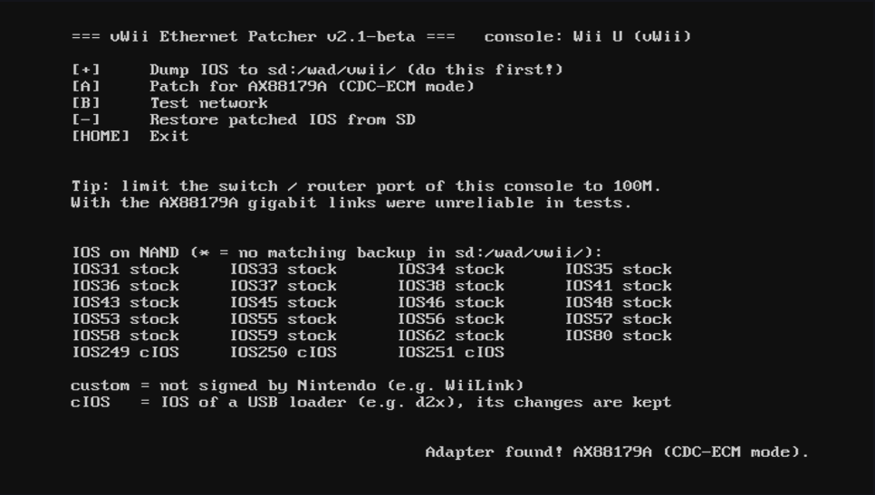 Main screen, AX88179A plugged in, all IOS stock / cIOS</td><td width="50%">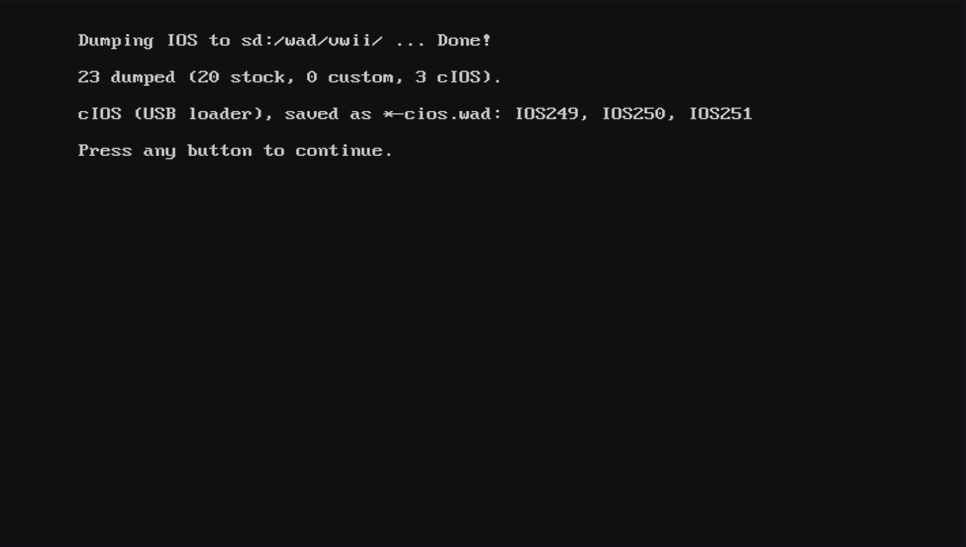 [+] Dump: 20 stock IOS and 3 cIOS saved</td></tr>
<tr><td width="50%">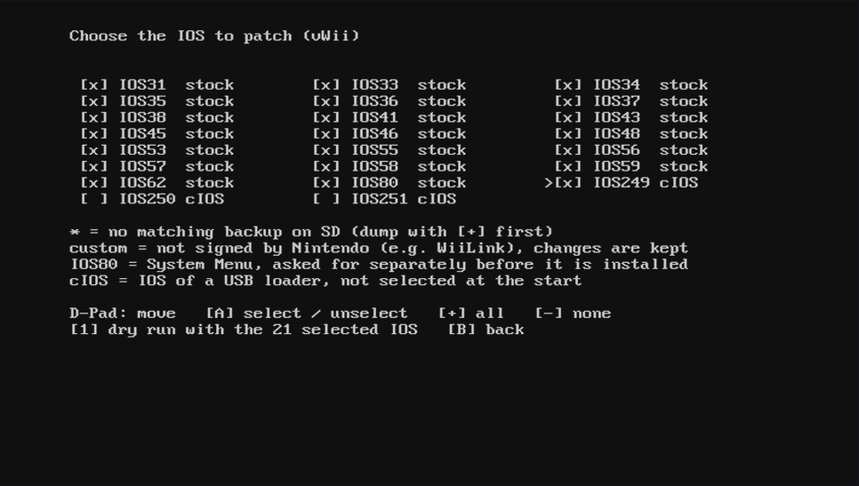 [A] Patch: choose the IOS (cIOS are not selected at the start)</td><td width="50%">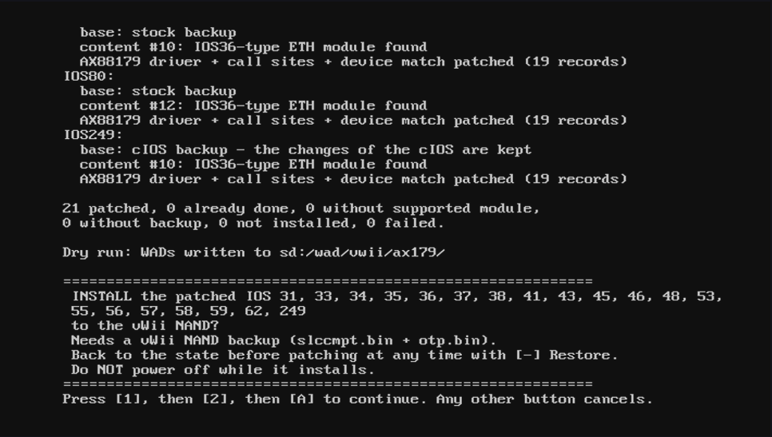 Dry run, then the install has to be confirmed with [1] [2] [A]</td></tr>
<tr><td width="50%">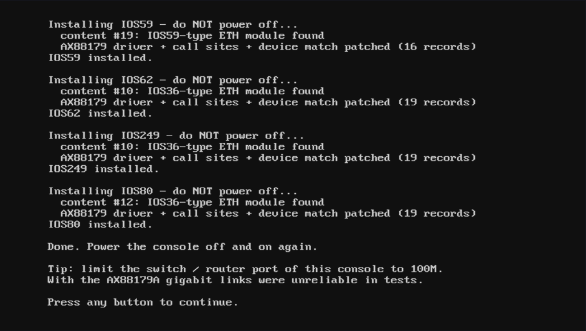 Install: every IOS is patched from its backup</td><td width="50%">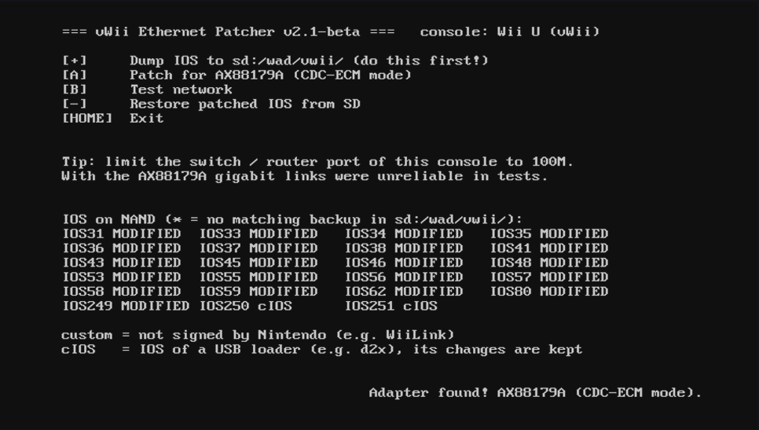 After the patch: the patched IOS are shown as MODIFIED</td></tr>
<tr><td width="50%">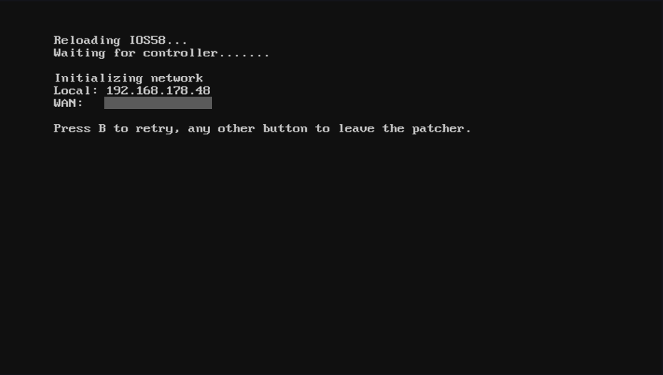 [B] Test network (WAN address hidden here)</td><td width="50%">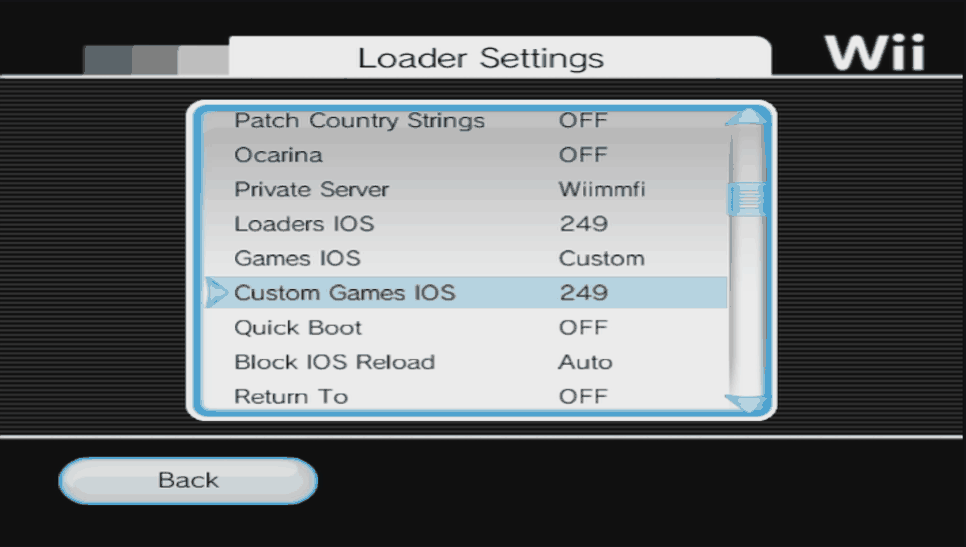 USB Loader GX: loader and games IOS set to the patched cIOS 249</td></tr>
<tr><td width="50%">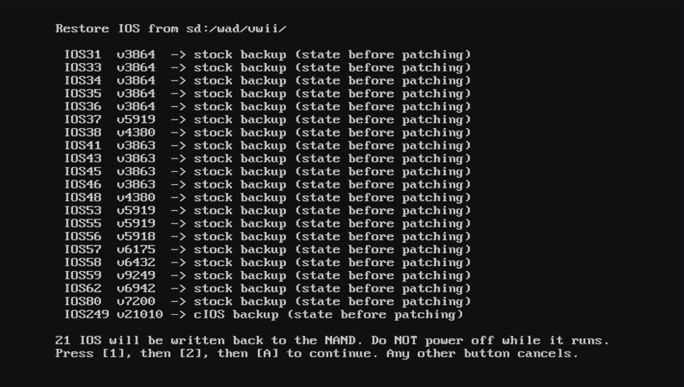 [-] Restore: every patched IOS and the backup it comes back from</td><td width="50%">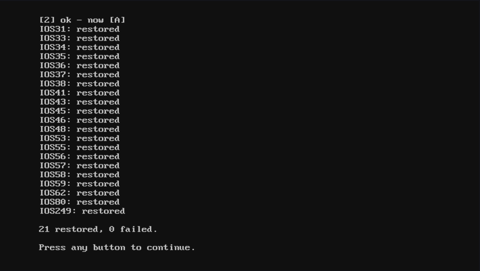 Restore done: all IOS back to the state before patching</td></tr>
</table>

### Wii with the Nintendo Switch LAN adapter (AX88179)

<table>
<tr><td width="50%">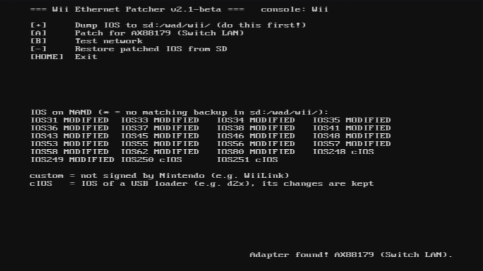 Wii: main screen with the Switch LAN adapter (AX88179), IOS patched</td><td width="50%">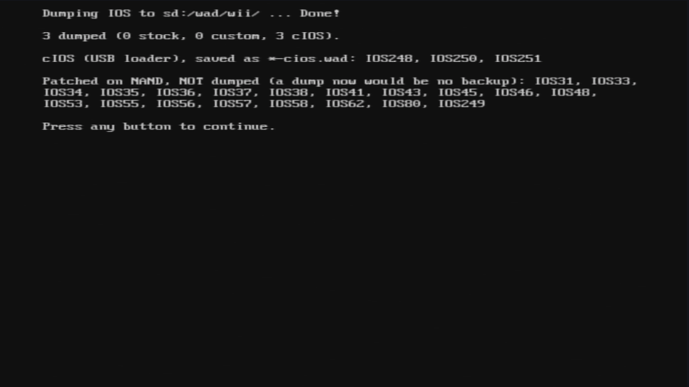 Wii: a dump only saves unpatched IOS, patched ones are never dumped</td></tr>
<tr><td width="50%">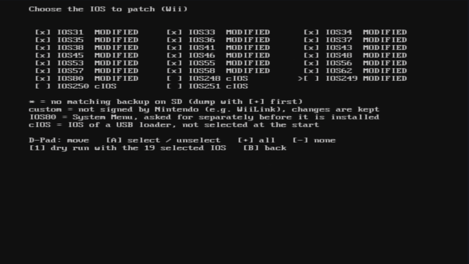 Wii: choosing the IOS (cIOS 248 to 251)</td><td width="50%">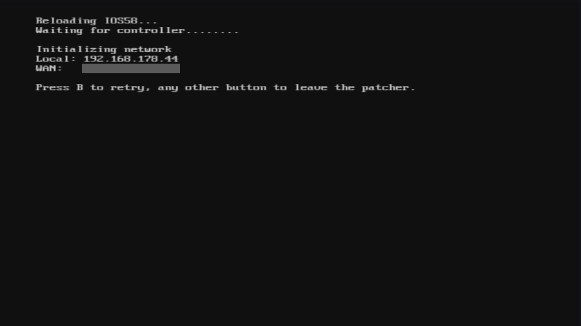 Wii: [B] Test network (WAN address hidden here)</td></tr>
</table>

## Supported adapters

| Adapter | USB PID | Status |
|---------|---------|--------|
| AX88772  | 0x7720 | works with the stock IOS |
| AX88772B | 0x772B | supported |
| AX88772C | 0x772B | supported |
| AX88772D | 0x1790 | experimental (patch of the original tool, not tested by this fork) |
| AX88179 (Nintendo Switch LAN adapter) | 0x1790 | all 20 IOS, 10/100M |
| AX88179A | 0x1790 | all 20 IOS (CDC-ECM mode), limit the port to 100M |

The AX88179 family is recognized by its USB product string ("AX88179" / "AX88179A").

### Tested with the AX88179 / AX88179A

| IOS | Used by | Tested |
|-----|---------|--------|
| IOS58 | homebrew | Wii U: AX88179 and AX88179A (DHCP, TCP, UDP up to 1472 bytes). Wii: AX88179 |
| IOS36 | Mario Kart Wii and many other games | Wii U: AX88179 and AX88179A, Mario Kart Wii (CTGP-R) races on Wiimmfi. Wii: AX88179 |
| IOS31, 33, 34, 35, 38 | games, IOS31: WiiConnect24 on a Wii | same module and kernel as IOS36; Wii (WiiLink): IOS31 with the AX88179 |
| IOS80 | System Menu | vWii with Priiloader: connection test. Wii (WiiLink): connection test, Message Board mail, link stable for days in WiiConnect24 standby |
| IOS53, 56, 57, 59, 62 | games | Wii U: network test passed |
| IOS37, 41, 43, 45, 46, 48, 55 | games | same module as IOS36, not tested on hardware yet |
| cIOS 249 (d2x, base 56) | games started from a USB loader | Wii: AX88179, Mario Kart Wii on Wiimmfi from USB Loader GX ("Games IOS" set to 249) |
| cIOS 248, 250, 251 (d2x) | games started from a USB loader | Wii; same modules as their base IOS; dump, patch and restore checked in an emulator test, not tested on hardware yet |
| vWii cIOS 249 (d2x v10, version 21010, IOS36-type ETH module) | games started from a USB loader | vWii: AX88179A (CDC-ECM): dump, patch, restore, network up to the server (Nintendo's error 20110: WFC is shut down). AX88772C: Mario Kart Wii on Wiimmfi (WFC menu) |
| vWii cIOS 249 (d2x v11-beta3, version 21011, base 57, IOS57-type ETH module) | games started from a USB loader | vWii: AX88179A: dump, patch, USB Loader GX with "Games IOS" = 249, Mario Kart Wii on Wiimmfi. Error 50320 showed up once and was gone after a restart (see "Known issues") |
| vWii cIOS 250, 251 (d2x v11-beta3, base 56 / 38, IOS36-type ETH module) | games started from a USB loader | vWii: dump, patch and restore only checked in an emulator test with real dumps (version 21011), not tested on hardware yet. The ETH module is the IOS36-type one that ran with the AX88179A in the d2x v10 cIOS249 and in IOS36 (the module is the same file, the base of v11 is another one) |
| vWii cIOS 250, 251 (d2x v10, IOS57- / IOS58-type ETH module) | games started from a USB loader | vWii: AX88772C, loader and games IOS set to the slot, Mario Kart Wii on Wiimmfi (WFC menu), restore. With the AX88179 only checked in an emulator test with dumps of a real vWii |

## Building

Requires [devkitPPC](https://devkitpro.org/) with libogc and libfat.

**Use libogc 3.1.0.** With libogc 3.2.1 the program starts and patches fine, but [B] Test network crashes
(in `net_init()`, seen on a Wii). The cause is not found yet. On Arch with devkitPro-pacman:
`sudo downgrade libogc` (pick 3.1.0) and keep it in `IgnorePkg`.

    make clean && make

New to the code? [HOW_IT_WORKS.md](HOW_IT_WORKS.md) explains the terms (IOS, TMD, WAD, ...), what each menu
entry does and which file does what.

The AX88179 patch data in `source/ax179_*_data.h` is generated from the stock modules; the driver sources,
the generator scripts and the emulator tests are in `tools/ax179/` (see its README). You do not need that folder to build or use the patcher.

## Origin of the files

The patcher is based on doworian's vWii Ethernet Patcher. Its files are kept in his style, so the
changes in them stay easy to compare with the original. Everything that was added later is in new
files. Paths are relative to `source/`.

**Unchanged from the original** (byte-identical):

| File | What it does |
|------|--------------|
| `patch_772bc.c/h`, `patch_772d.c/h`, `patch_common.h` | AX88772B / C / D patches |
| `identify.h`, `isfs.h`, `wad.h` | headers |
| `sha1.c/h`, `rijndael.c/h` | SHA-1 (Steve Reid) and AES (Mike Scott) |
| `memory/` | MEM2 allocator (from WiiFlow) |

**Original, with small fixes** (the original code and style are kept):

| File | Changed |
|------|---------|
| `IOSPatcher.c/h` | the original ticket is put back after an install (vWii key index 2); TMD completeness check; the AES IV of a content is its index from the TMD, not its position (they differ in d2x cIOS); `get_IOS()` is gone (the AX88772 patch uses the backups of `backup.c` now) |
| `isfs.c` | only complete reads from the NAND count; shared contents always come from `/shared1`; log messages |
| `wad.c` | a short or broken WAD file is an error instead of being read past its end |
| `identify.c` | the vWii-only patterns are only searched on the vWii |
| `tools.c/h` | log file `sd:/ethernet_patcher.log` |
| `makefile` | file name `makefile` instead of `Makefile` |

**Rewritten:**

| File | What it does |
|------|--------------|
| `main.c` | all menus. Based on the original `main.c`, but rewritten for the new menu entries (dump, restore, AX88179 IOS list, network test); the AX88772 path patches as in the original, but only from a matching backup |

**New:**

| File | What it does |
|------|--------------|
| `patch_179.c/h`, `ax179_*_data.h` | AX88179 / AX88179A patch (the data files are generated by `tools/ax179/`) |
| `backup.c/h` | names of the backup files, finds the backup that matches the NAND |
| `sigcheck.c/h` | checks the Nintendo signature of a TMD: stock, MODIFIED or custom |
| `cios.c/h` | cIOS of USB loaders: the slots 248 to 251, tells a cIOS from a MODIFIED IOS |
| `platform.c/h` | Wii or vWii, list of the IOS of the console (with the installed cIOS) |
| `tools/ax179/` (outside `source/`) | driver sources, patch generators and emulator tests |
| `meta.xml`, `HOW_IT_WORKS.md` | Homebrew Channel entry, short tour through the code |

## About AI assistance

This fork was written and checked with AI assistance. But it was not vibecoded. Every step was supervised closely and precisely checked.
The decisions, the tests on a real Wii and a real vWii, and the release are the author's. Every change
was run on the console before it counted as tested, and the tables above say what was only tried in an
emulator.

## Credits

**The original and its sources**

- **doworian**: the original vWii Ethernet Patcher (the repository was deleted; the author agreed to a
  GPL publication). The AX88772B / C / D patches are his and unchanged. AX88179 / AX88179A support, the Wii
  port, cIOS support, backups and restore were added later.
- **[Linux kernel asix drivers](https://github.com/torvalds/linux/tree/master/drivers/net/usb)** and
  SDIO's **[wafel_ax88772b](https://github.com/StroopwafelCFW/wafel_ax88772b)**: register analysis of the
  adapters, read as documentation.
- **postloader** (stfour): the patches of the running IOS in `identify.c`.
- **WiiFlow**: the MEM2 allocator (`memory/`). **Mike Scott**: AES (`rijndael.c`). **Steve Reid**: SHA-1
  (`sha1.c`).
- **devkitPro and libogc**: toolchain and Wii library. The libogc sources were also read for how the
  network and USB calls behave.

**Programs this patcher works with**

- **d2x cIOS and its authors**: the cIOS of USB loaders that the patcher recognizes, dumps, patches and
  restores. Its IOS were read to learn their layout (content order, tickets); no code was copied.
- **USB Loader GX**: the loader used to test the cIOS (Loader IOS and Games IOS settings).

**Used for testing**

- **BootMii**: NAND backups before every test. **BlueDump**: reading the cIOS on the Wii and the vWii.
- **Wiimmfi** and **WiiLink WFC**: the servers used to test online play (Mario Kart Wii). Nothing of them
  is part of this patcher.
- Hardware: a Wii and a Wii U (vWii) with the Nintendo Switch LAN adapter (AX88179), an AX88179A, an
  AX88772 and an AX88772C.
